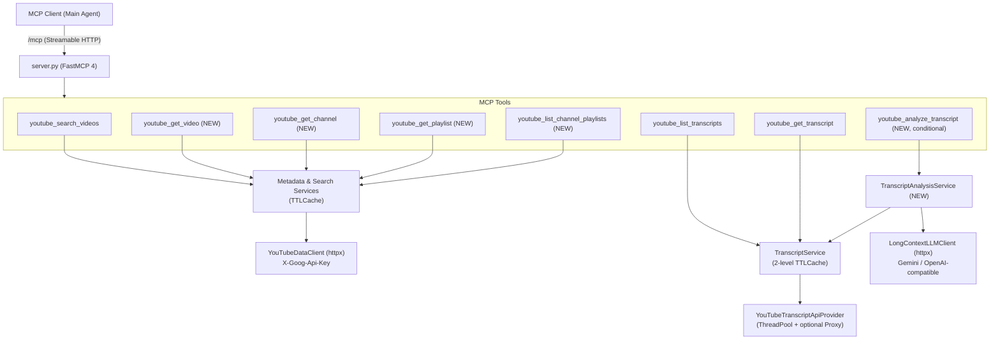

# Specification: Extended Video Research & Transcript Subagent for TubeTrace MCP

## 1. Goals & Scope

Extend **TubeTrace MCP** from a 3-tool server into a comprehensive YouTube research toolkit while preserving its core architectural invariants (stateless Streamable HTTP at `/mcp`, fail-closed auth, strict input allowlists, bounded upstream calls, in-memory LRU+TTL caching, and secret redaction):

1. **Transcript Preprocessing / Subagent Q&A (`youtube_analyze_transcript`)**: Load an entire video transcript into a configurable long-context LLM on the server side in a single pass and return only the synthesized answer/analysis (with timestamp citations), keeping raw transcripts out of the main agent's context window.
2. **Rich Video Metadata (`youtube_get_video`)**: Retrieve full video metadata (channel info, full description, duration, tags, statistics, default audio/caption languages, and optional playlist context if a playlist URL/ID is provided) without downloading the transcript.
3. **Channel & Playlist Exploration (`youtube_get_channel`, `youtube_get_playlist`, `youtube_list_channel_playlists`)**: Retrieve channel or playlist metadata together with paginated lists of their videos and playlists using the low-cost YouTube Data API v3 endpoints (1 unit out of the 10,000/day general quota bucket per call, avoiding the 100/day `search.list` quota).

---

## 2. Architecture Overview



---

## 3. Feature 1: Transcript Preprocessing / Subagent (`youtube_analyze_transcript`)

### 3.1 Rationale & Workflow
Long videos (1–3 hours) contain 2,000–10,000+ transcript segments (~100 KB–500 KB of text). Fetching all pages via `youtube_get_transcript` floods the primary coding/chat agent's context window.

Because `TranscriptService` already downloads and caches the complete `RawTranscript` in memory (up to `TRANSCRIPT_MAX_SEGMENTS=50,000` and `TRANSCRIPT_MAX_BYTES=8 MiB`), the server can:
1. Resolve and fetch the full transcript once (or read it from `TTLCache`).
2. Optionally filter by `start_seconds` / `end_seconds` if the caller wants to analyze a specific chapter or time range.
3. Format the entire transcript with compact timestamps (`[125.4s] text...`) so the subagent model can reference exact moments.
4. Send the full transcript + the caller's `prompt` in **one single-pass request** to a configured long-context model (e.g., `gemini-3-flash-preview` with a 1M token window).
5. Return a compact, structured response containing the answer and optional timestamped citations (`start_seconds`, `timestamp_url`, `label`).

### 3.2 Prompt-Injection & Untrusted Data Guardrails
In accordance with the security invariant that transcripts are untrusted third-party content:
* The subagent LLM has **no tools, no code execution, and no network access**.
* The system instruction explicitly fences the transcript inside `<untrusted_transcript>...</untrusted_transcript>` tags and instructs the model to ignore any instructions or role-play commands embedded inside the transcript text.

### 3.3 Tool Contract: `youtube_analyze_transcript`

**Input Schema (`AnalyzeTranscriptRequest`)**:
| Parameter | Type | Default | Description |
| :--- | :--- | :--- | :--- |
| `video` | `str` | *required* | 11-character YouTube video ID or allowlisted YouTube URL. |
| `prompt` | `str` | *required* | Question or analysis task to answer from the transcript (`1..4000` chars). |
| `languages` | `list[str] \| None` | `None` | Preferred transcript language codes in priority order (e.g. `["uk", "en"]`). |
| `prefer_manual` | `bool` | `True` | Prefer manually created captions over ASR within a language tier. |
| `start_seconds` | `float \| None` | `None` | Optional start bound (seconds) to restrict the transcript fed to the model. |
| `end_seconds` | `float \| None` | `None` | Optional end bound (seconds) to restrict the transcript fed to the model. |
| `output_language` | `str \| None` | `None` | Optional language for the generated answer (defaults to the language of `prompt`). |

**Output Schema (`AnalyzeTranscriptResult`)**:
```json
{
  "video_id": "dQw4w9WgXcQ",
  "video_url": "https://www.youtube.com/watch?v=dQw4w9WgXcQ",
  "language": "English",
  "language_code": "en",
  "is_generated": false,
  "selection": "requested_language",
  "transcript_provider": "youtube_transcript_api",
  "transcript_cache_hit": true,
  "llm_provider": "gemini",
  "llm_model": "gemini-3-flash-preview",
  "total_segments": 1420,
  "analyzed_segments": 1420,
  "transcript_characters": 68450,
  "start_seconds": null,
  "end_seconds": null,
  "answer": "Detailed answer synthesized from the full transcript...",
  "citations": [
    {
      "start_seconds": 342.5,
      "timestamp_url": "https://www.youtube.com/watch?v=dQw4w9WgXcQ&t=342s",
      "label": "Discussion of connection pooling"
    }
  ],
  "usage": {
    "input_tokens": 18200,
    "output_tokens": 640
  },
  "retrieved_at": "2026-10-17T19:00:00Z"
}
```

### 3.4 LLM Configuration (`Settings`) & Conditional MCP Tool Registration
Implemented directly over `httpx.AsyncClient` (no heavy third-party LLM SDK required):
* `TRANSCRIPT_LLM_PROVIDER`: `"gemini"` (default, Google Generative Language REST API) or `"openai"` (any OpenAI-compatible `/v1/chat/completions` endpoint: OpenAI, OpenRouter, vLLM, etc.).
* `TRANSCRIPT_LLM_API_KEY`: `SecretStr | None` — registered in `Settings.redaction_secrets` so it is never logged or echoed.
* `TRANSCRIPT_LLM_MODEL`: `str` (defaults to `"gemini-3-flash-preview"` for `gemini`; required when `openai` is selected).
* `TRANSCRIPT_LLM_BASE_URL`: `str | None` (defaults to `https://generativelanguage.googleapis.com/v1beta` for `gemini` or `https://api.openai.com/v1` for `openai`).
* `TRANSCRIPT_LLM_MAX_INPUT_CHARS`: `int` (default `2_000_000` chars $\approx$ 500k tokens; raises `TRANSCRIPT_TOO_LARGE` if exceeded).
* `TRANSCRIPT_LLM_MAX_OUTPUT_TOKENS`: `int` (default `4096`).
* `TRANSCRIPT_LLM_TIMEOUT_SECONDS`: `float` (default `90.0`; `ANALYSIS_TOOL_TIMEOUT_SECONDS` defaults to `110.0`, staying below Caddy's `120s` and Horizon's `170s` limits).

> [!IMPORTANT]
> **Conditional MCP Exposure (`tools/list`)**:
> When LLM connection parameters are not configured (`settings.llm_configured == False`, i.e., `TRANSCRIPT_LLM_API_KEY` is unset), `youtube_analyze_transcript` is **not registered** on the FastMCP server in `create_server()` and is omitted from `SERVER_INSTRUCTIONS`. MCP clients will not see the tool in `tools/list` and will never make unnecessary calls to an unconfigured LLM tool.
> Conversely, if partial or invalid LLM parameters are supplied (e.g., `TRANSCRIPT_LLM_PROVIDER=openai` with a key but no model, or an invalid `TRANSCRIPT_LLM_BASE_URL`), `Settings` fails closed at startup (`check-config` / `serve`).

---

## 4. Feature 2: Video Metadata Without Transcript (`youtube_get_video`)

### 4.1 Upstream API & Quota
Uses the official YouTube Data API v3 `videos.list` endpoint (`GET /youtube/v3/videos?part=snippet,contentDetails,statistics,liveStreamingDetails&id=...`):
* **Quota cost**: **1 unit** out of the 10,000/day general quota (does **not** touch the 100/day `search.list` bucket).
* **Playlist context**:
  * In YouTube's data model, a video does not have a single "parent playlist" in `videos.list` (since any user can add a video to any playlist).
  * **However**, if the caller passes a video URL containing `?list=PL...` (e.g. `https://www.youtube.com/watch?v=dQw4w9WgXcQ&list=PL12345`) or passes an explicit `playlist` argument, the parser extracts both `video_id` and `playlist_id`.
  * When `playlist_id` is present (in the URL or parameter), the service also resolves the playlist metadata (`playlist_id`, `title`, `playlist_url`, `channel_id`, `channel_title`, `item_count`) via `playlists.list` (cached in `TTLCache`).

### 4.2 Tool Contract: `youtube_get_video`

**Input Schema (`GetVideoRequest`)**:
| Parameter | Type | Default | Description |
| :--- | :--- | :--- | :--- |
| `video` | `str` | *required* | 11-character video ID or allowlisted YouTube URL (if the URL includes `list=...`, playlist metadata is also resolved). |
| `playlist` | `str \| None` | `None` | Optional explicit playlist ID or URL to resolve playlist metadata alongside the video. |

**Output Schema (`VideoMetadataResult`)**:
```json
{
  "provider": "youtube_data_api_v3",
  "video_id": "dQw4w9WgXcQ",
  "video_url": "https://www.youtube.com/watch?v=dQw4w9WgXcQ",
  "title": "Video Title",
  "description": "Full untruncated video description...",
  "channel_id": "UCuAXFkgsw1L7xaCfnd5JJOw",
  "channel_title": "Channel Name",
  "channel_url": "https://www.youtube.com/channel/UCuAXFkgsw1L7xaCfnd5JJOw",
  "published_at": "2009-10-25T06:57:33Z",
  "duration_iso": "PT3M33S",
  "duration_seconds": 213,
  "has_captions": true,
  "definition": "hd",
  "default_language": "en",
  "default_audio_language": "en",
  "tags": ["music", "pop"],
  "category_id": "10",
  "view_count": 1500000000,
  "like_count": 17000000,
  "comment_count": 2300000,
  "live_broadcast_content": "none",
  "thumbnail_url": "https://i.ytimg.com/vi/dQw4w9WgXcQ/maxresdefault.jpg",
  "playlist": {
    "playlist_id": "PL1234567890",
    "playlist_url": "https://www.youtube.com/playlist?list=PL1234567890",
    "title": "Playlist Name",
    "channel_id": "UCuAXFkgsw1L7xaCfnd5JJOw",
    "channel_title": "Channel Name",
    "item_count": 42
  },
  "retrieved_at": "2026-10-17T19:00:00Z",
  "cache_hit": false
}
```
*(If no playlist was in the URL or `playlist` parameter, `playlist` is `null`.)*

---

## 5. Feature 3: Channel & Playlist Metadata + Video Lists

### 5.1 URL & Identifier Parsers (`video_input.py`)
Extend the strict allowlist parser in `src/tubetrace_mcp/video_input.py` with:
* **`parse_channel_input(value: str) -> ChannelTarget`**:
  * Accepts a bare channel ID (`UC[A-Za-z0-9_-]{22}`), a handle (`@handle`), or an allowlisted YouTube URL (`/channel/UC...`, `/@handle`).
  * Rejects non-YouTube hosts, credentials, ports, and unsupported URL forms with `INVALID_CHANNEL_INPUT`.
* **`parse_playlist_input(value: str) -> str`**:
  * Accepts a bare playlist ID (`PL...`, `UU...`, `OLAK5uy_...`, `RD...`, `FL...`, `LL...`) or an allowlisted YouTube URL containing `?list=...` (`/playlist?list=...`, `/watch?v=...&list=...`).
  * Rejects invalid inputs with `INVALID_PLAYLIST_INPUT`.

### 5.2 Tool: `youtube_get_channel`
Fetches channel metadata via `channels.list` (`part=snippet,contentDetails,statistics`, using `id=UC...` or `forHandle=@...`) and, when `include_videos=True` (default), fetches one page of the channel's uploaded videos from its `uploads` playlist (`UU...`) via `playlistItems.list`.

* **Why `playlistItems.list` instead of `search.list`?**
  Every YouTube channel has an uploads playlist (`contentDetails.relatedPlaylists.uploads`). Reading it via `playlistItems.list` costs **1 unit out of 10,000/day** instead of burning the 100/day `search.list` quota.
* **Caching**: Channel metadata is cached in `TTLCache` (`channel:<id_or_handle>`), so paginating through a channel's videos with `page_token` only makes **1 upstream call** (`playlistItems.list`).

**Input Schema (`GetChannelRequest`)**:
| Parameter | Type | Default | Description |
| :--- | :--- | :--- | :--- |
| `channel` | `str` | *required* | Channel ID (`UC...`), handle (`@name`), or YouTube channel URL. |
| `include_videos` | `bool` | `True` | Whether to include a page of the channel's uploaded videos. |
| `max_results` | `int` | `20` | Number of uploaded videos per page (`1..50`). |
| `page_token` | `str \| None` | `None` | `next_page_token` to paginate through the channel's uploads. |

**Output Schema (`ChannelResult`)**:
* `channel_id`, `channel_url`, `title`, `description`, `custom_url` (`@handle`), `country`, `published_at`, `thumbnail_url`
* `subscriber_count`, `video_count`, `view_count`, `uploads_playlist_id`
* `videos`: `list[PlaylistVideoItem] | None` (`position`, `video_id`, `video_url`, `title`, `description`, `published_at`, `thumbnail_url`)
* `next_page_token`, `prev_page_token`, `retrieved_at`, `cache_hit`

### 5.3 Tool: `youtube_get_playlist`
Fetches playlist metadata (`playlists.list`, `part=snippet,contentDetails`) and one page of videos in the playlist (`playlistItems.list`, `part=snippet,contentDetails,status`).
* Playlist metadata is cached independently in `TTLCache` (`playlist_meta:<playlist_id>`), so subsequent pages (`page_token`) only fetch `playlistItems.list` (1 upstream call).

**Input Schema (`GetPlaylistRequest`)**:
| Parameter | Type | Default | Description |
| :--- | :--- | :--- | :--- |
| `playlist` | `str` | *required* | Playlist ID (`PL...`, `UU...`, `OLAK5uy_...`) or YouTube URL with `list=...`. |
| `include_videos` | `bool` | `True` | Whether to fetch a page of videos in the playlist. |
| `max_results` | `int` | `25` | Videos per page (`1..50`). |
| `page_token` | `str \| None` | `None` | `next_page_token` for the next page of playlist items. |

**Output Schema (`PlaylistResult`)**:
* `playlist_id`, `playlist_url`, `title`, `description`, `channel_id`, `channel_title`, `published_at`, `item_count`, `thumbnail_url`
* `items`: `list[PlaylistVideoItem] | None` (`position`, `video_id`, `video_url`, `title`, `description`, `video_owner_channel_id`, `video_owner_channel_title`, `published_at`, `added_at`, `privacy_status`, `thumbnail_url`)
* `next_page_token`, `prev_page_token`, `retrieved_at`, `cache_hit`

### 5.4 Tool: `youtube_list_channel_playlists`
Allows discovering all public playlists created by a channel (`GET /youtube/v3/playlists?part=snippet,contentDetails&channelId=UC...`).
* **Input**: `channel` (ID, `@handle`, or URL), `max_results` (`1..50`, default `25`), `page_token`.
* **Output**: `channel_id`, `playlists[]` (`playlist_id`, `playlist_url`, `title`, `description`, `item_count`, `published_at`, `thumbnail_url`), `next_page_token`.

---

## 6. New Error Codes (`errors.py`)

| Code | Meaning | Retryable |
| :--- | :--- | :--- |
| `INVALID_CHANNEL_INPUT` | Not a valid `UC...` ID, `@handle`, or allowlisted YouTube channel URL | `false` |
| `INVALID_PLAYLIST_INPUT` | Not a valid playlist ID or allowlisted YouTube URL with `list=` | `false` |
| `VIDEO_NOT_FOUND` | Video was not found by `videos.list` | `false` |
| `CHANNEL_NOT_FOUND` | Channel was not found by `channels.list` | `false` |
| `PLAYLIST_NOT_FOUND` | Playlist does not exist or is private (404 / 403 `playlistForbidden`) | `false` |
| `LLM_UPSTREAM_ERROR` | Long-context LLM provider returned an error, invalid key, or rate limit | depends (429/5xx `true`) |

*(Because `youtube_analyze_transcript` is registered in MCP only when `TRANSCRIPT_LLM_API_KEY` is configured, no `LLM_NOT_CONFIGURED` error code is needed during normal `tools/list` $\rightarrow$ `tools/call` operation.)*
